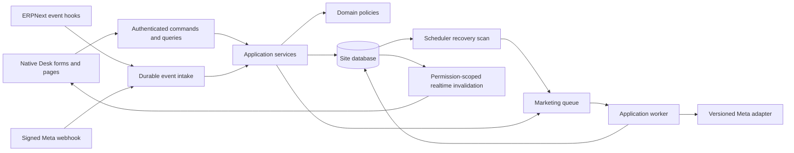

# Application architecture

Requirements: WA-R01, WA-R08, WA-R11, WA-R13, WA-R15. See [ADR-001](decisions/ADR-001-APP-AND-DESIGN-BASELINE.md).

## Boundaries

Create one separate app `tag_marketing`, requiring ERPNext and Frappe, initially tested against the [inspected baseline](FRAMEWORK_AND_SETUP.md). Declare compatible `<17` dependency bounds and a tested minimum consistent with used APIs; the initial release must not claim earlier revisions were tested. Payroll, HRMS and localisation are optional neighbours.

Use these future package responsibilities:

```text
tag_marketing/
  domain/                 # pure eligibility, state and journey decisions
  application/            # commands, queries, orchestration and policy checks
  infrastructure/         # Meta client, repositories, queue, media and clock
  api/                    # whitelisted command/query and signed webhook handlers
  integrations/           # ERPNext hooks and optional navigation adapter
  whatsapp_marketing/     # module-owned DocTypes, pages, reports and Desk metadata
  public/                 # scoped bundles and icons
  setup/                  # install/migrate seed helpers and role grants
  patches/                # explicit versioned data migrations
  tests/                  # unit, integration and failure tests
```

Domain functions accept values and typed inputs; they do not read request globals or call HTTP. Application services own transactions and permissions. Repositories use Frappe persistence and explicit locking. A provider adapter translates internal requests to a versioned Meta contract. Avoid generic abstractions without an actual second use, but keep provider traffic out of controllers.



## Transactions and work ownership

- Commands validate actor, company, document revision and domain transition before writing. Database constraints provide race protection in addition to Python checks.
- Source hooks persist a bounded event in the source transaction; they do not send messages. Rollback removes the event. Enqueue only after commit.
- Webhooks verify signatures before parsing trusted content. Persist receipt before acknowledgement. The recovery scanner handles committed events missed by enqueue.
- Approval builds a versioned snapshot, verifies counts/hash and records a manager decision. Concurrent edits make the approval command stale and fail safely.
- Workers claim an outbox item in a short transaction, commit, perform HTTP, then persist results in a separate transaction. Never keep row locks across network I/O.
- Realtime carries record IDs and invalidation/progress signals, not message bodies broadcast to the site. Clients refetch through authorised APIs.

## Installation and ownership

Ship owned metadata using the supported module JSON mechanisms of this checkout. Standard Dock/Sidebar/Workspace records, roles and metrics have stable names. Install/migrate creates missing records without resetting user customisations. Run repeat-install/migrate tests.

Use an owned app tile and sidebar as the default. An optional `za_local_core` navigation adapter may mount the owned Dock through a verified public extension point; absence must not fail installation. No unconditional imports from localisation. Do not edit another app's metadata to add links.

## Managed records

Expose normal CRUD only for editable configuration. Workflow fields, snapshot hashes, consent evidence, messages, outbox state and audit records are service-managed. Controller validation blocks bypasses through generic REST, Data Import and bulk editing. Restricted background operations use an explicit initiating actor and company; they do not impersonate Administrator to bypass audience permissions.

Detailed storage lives in [data model](DATA_MODEL.md), command contracts in [API contracts](API_CONTRACTS.md), and provider recovery in [reliability](MESSAGING_AND_RELIABILITY.md).
