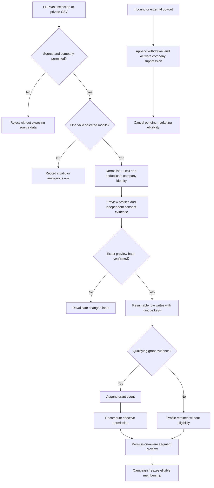

# Audience and consent flow

Triggers: permitted ERPNext source selection, private CSV import or a new consent/withdrawal event. Prerequisites: selected company, source access, explicit phone/country mapping and evidence validation for grants.

Imports first validate without profile mutation. Confirmation queues a durable operation and processes at most 100 ledger rows per committed chunk. Recovery requeues stale workers; imported row states let a retry continue after the last committed chunk without duplicate contacts or grant evidence. Unique company/phone identity prevents duplicates. Invalid rows remain private diagnostics while valid rows can complete.

Withdrawal takes effect before ordinary automations and across all sending numbers. New evidence must be later than a withdrawal; a replayed historical grant does not restore permission. Coordinate withdrawal and send eligibility in short database transactions. Provider submissions already in flight cannot be recalled.

Retention may remove conversation content without deleting the minimised suppression key needed by the configured policy. Routine reimport cannot bypass suppression.

Outcome: eligible or ineligible contacts with explainable reasons and traceable evidence; approval later freezes only membership, not future immunity from opt-outs. See [integration](../ERPNext_INTEGRATION.md), [contact page](../pages/CONTACTS_AND_IMPORTS.md), [P3 tasks](../tasks/P3-AUDIENCES-AND-TEMPLATES.md) and [WA-A03/WA-A04](../TESTING_AND_ACCEPTANCE.md).
