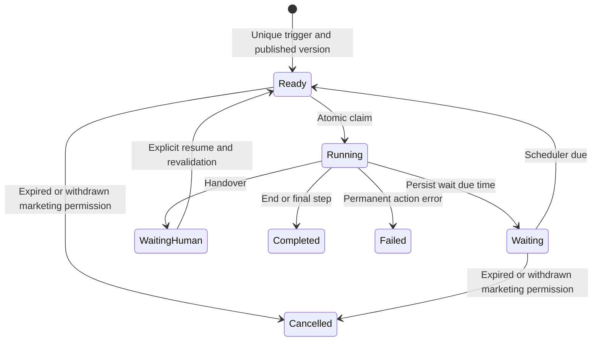

# Automation definition and execution

Owner: WA-R11, WA-R12. Native editor contract: [Automations page](../pages/AUTOMATIONS.md). Storage: [data model](../DATA_MODEL.md).

## Definition schema

A versioned definition contains `schema_version=1`, one `trigger`, optional trigger filters, ordered `steps`, purpose and exit policy. Each step has stable `step_id`, allowlisted `action`, typed `parameters`, optional forward `next_step_id` and, for conditions, `otherwise_step_id`. End has no next target. Reject unknown keys/actions, missing targets, backward edges, cycles, unreachable steps and more than 100 steps.

Supported triggers:

- First inbound message: once per company/contact/number conversation identity.
- Inbound keyword: exact normalised keyword or prefix selected explicitly; no arbitrary regex in v1. Suppression keywords have priority.
- Campaign reply: provider reply context links to a campaign message; inferred replies do not trigger exact-reply flows by default.
- Marketing opt-in recorded: effective state changes to Granted from qualifying evidence.
- Lead Created, Customer Created and Sales Order Submitted: source events from the owned ERPNext adapter with explicit company/identity mapping.

Condition fields: contact tags/language/consent state, trigger type, source status and a selected allowlisted source field. Operators: equals, not-equals, in, contains-tag, exists; use type validation. No Python/JS/Jinja execution.

Supported actions:

- **Condition:** choose next/otherwise forward target from typed comparison.
- **Wait:** positive bounded duration (maximum 30 days per step) persisted as UTC due_at, or absolute valid UTC due time. Define run expiry explicitly at publication; waits beyond it terminate Cancelled/expired.
- **Send Template:** template reference, validated constant/source variable mappings and purpose; current approval/consent/readiness apply at execution.
- **Send In-Window Reply:** fixed approved-by-manager plain text or supported private media, used only for Support purpose within a live customer window.
- **Add Tag / Remove Tag:** same-company WA Tag.
- **Assign Conversation:** authorised agent/team; create conversation if sender/contact resolves; assignment does not grant source CRM rights.
- **Handover:** set Human mode, record Waiting Human and route to selected permitted team.
- **End:** mark Completed.

Marketing automations need consent at every send. Utility requires a valid associated transaction and appropriate template. Support reply steps are evaluated against actual inbound context; a CRM-created contact without a window cannot receive free-form support content. Automated send steps are blocked in Human mode.

Run definition also records `expires_after_hours` (required positive value, maximum 90 days). This is a chosen v1 safety bound, not a provider window. Event replays use source identity/version keys. Different published versions do not replay already-processed historical triggers automatically.

## Publication and execution flow

Diagram alias `WaitingHuman` is stored **Waiting Human**. Paused definitions block claims; they do not mutate pinned versions. New inbound in Human mode routes to the team, not automatic sending.

Manager validates and simulates a draft, then publishes the same definition hash. Store an immutable version. Source hooks commit an event before enqueue; inbound events create triggers only after opt-out processing. Intake deduplicates triggers across replay and version publication; publish affects future events only.

Workers claim runs, recheck principal/eligibility, and execute effective steps once using `(run, step_id)` keys. Sends create the existing outbox operation, never direct provider calls from the engine. Waiting persists and releases the worker; restarting the process neither loses waits nor restarts completed actions.

Simulation uses synthetic bounded context and a fake clock/provider repository. Return the chosen path, planned parameters, eligibility failures and human handover; make no source/database business mutations or network sends.

Failures: revoked run-as permission, invalid transaction context, paused template, stale service window, expired run and uncertain send remain explicit diagnostics. A worker crash after message creation reuses the same logical key. Failed runs require a reviewed repair/new trigger; no unrestricted Retry Entire Journey button.

Acceptance: [WA-A11](../TESTING_AND_ACCEPTANCE.md). Work: [P6 tasks](../tasks/P6-AUTOMATIONS.md).
