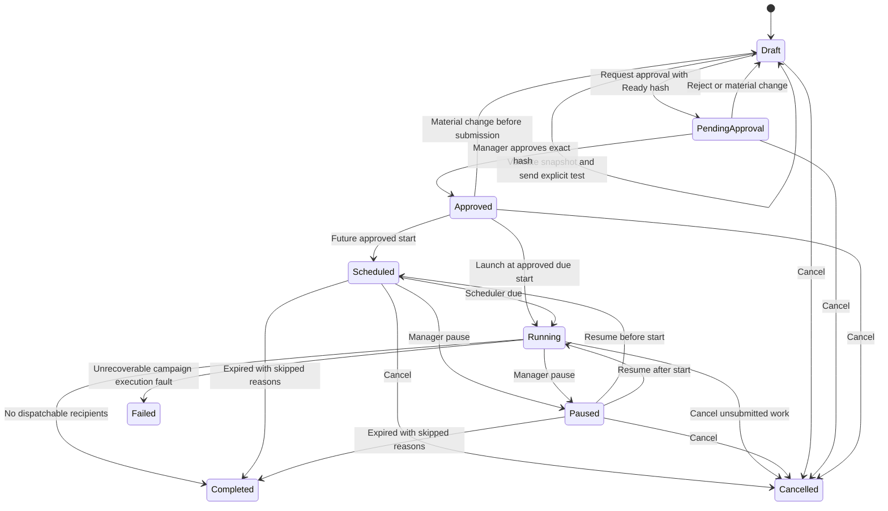

# Campaign approval and dispatch flow

Trigger: marketer prepares a Draft. Prerequisites: eligible audience, ready sender, approved template, complete variable mappings, schedule/expiry and source access.

Diagram aliases `PendingApproval` means stored **Pending Approval**. Interrupted or expired pre-start work follows the service rules; expiry stops dispatch and records reasons, rather than pretending it was sent.

Snapshot generation persists Building → Ready only after all chunks/hashes/counts verify. Require accepted same-hash test evidence. Approval compares manager role, current revision and hash atomically. Material changes before first submission return Draft; afterward require Clone. A test message is not a campaign-recipient send.

At launch, create logical recipient messages/outbox once. Workers claim bounded batches, recheck live gates, reserve cap/budget, record Submitting and commit before HTTP. A later opt-out/template pause/source access revocation skips or fails pending items with reasons; no replacement audience members are added.

Pause/Cancel stops unsubmitted work when workers next recheck state. In-flight requests can complete. Resume never resets accepted/unknown items. An unknown result remains visible even when dispatch drains and the campaign is Completed. Delivery/read callbacks continue after Completed/Cancelled.

Failures: stale approval, zero eligible recipients, too-large snapshot, rejected template, incomplete variables and expired schedule block launch. Authentication/provider policy errors stop affected sending. Recoverable failures and unknown handling follow [reliability](../MESSAGING_AND_RELIABILITY.md).

Outcome: exact approved membership and content, auditable dispatch outcomes, no silent duplication. See [campaign page](../pages/CAMPAIGNS.md), [P4 tasks](../tasks/P4-CAMPAIGNS-AND-DISPATCH.md), [WA-A07/WA-A08](../TESTING_AND_ACCEPTANCE.md).
