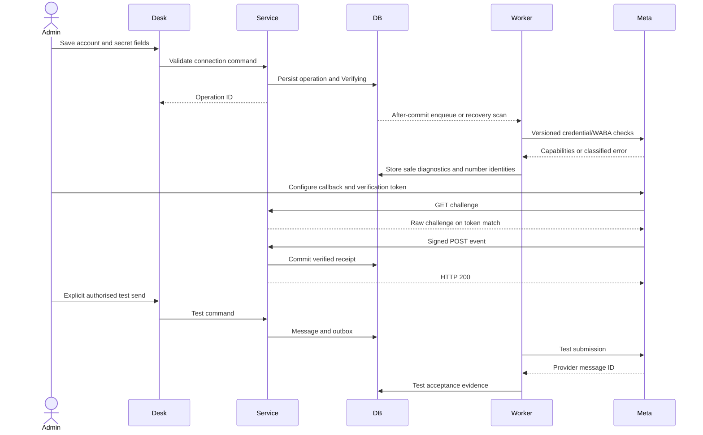

# Connection and onboarding flow

Trigger: administrator creates a connection. Prerequisites: configured company, supported Meta business/app/number, explicit API version, protected credentials and public HTTPS callback. No business signup is performed by the app in v1.

Persist account validation, actual signed receipt and test evidence separately. A GET challenge is not successful inbound delivery. Connection Ready does not imply global live sending is enabled; [release policy](../OPERATIONS_AND_RELEASE.md) controls that gate.

Failures: invalid credentials/API version leave safe diagnostics; wrong WABA/number is rejected; unknown route or invalid signature cannot create trusted business records. Secret edits clear readiness. Disabled connections continue authenticated event intake for historical outcomes but cannot submit new messages.

Recovery: revalidate through the same idempotent command. Duplicate sync/test requests reuse logical operations; tests never happen automatically when a user opens the page. Missing queue publication is recovered from committed operations.

Outcome: numbers/templates synchronised, verified callback and accepted authorised test, or explicit blocked/degraded state. See [Connections page](../pages/CONNECTIONS.md), [P2 tasks](../tasks/P2-CONNECTIONS-AND-WEBHOOKS.md) and [WA-A05](../TESTING_AND_ACCEPTANCE.md).
