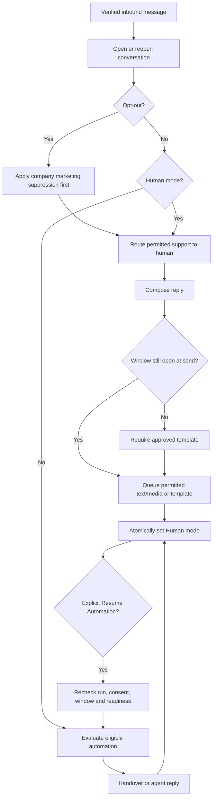

# Inbox and human handover flow

Trigger: inbound message, agent action or an automation handover step. Prerequisites: authorised assignment/team access, resolved conversation identity and healthy connection for outgoing messages.

Agent reply and automatic sending compete through conversation coordination: a recorded handover blocks not-yet-submitted automatic replies. In-flight provider requests cannot be recalled. Resume is explicit and does not refresh the customer service window.

Lists/messages use cursor pagination and permission-scoped invalidations. Reassignment immediately blocks subsequent reads/downloads by a former agent; notifications carry IDs rather than body text. Per-user read cursors do not change another agent's read history.

Validate window at compose query and worker submission. A queued free-form reply that becomes stale fails `WINDOW_CLOSED`; retain draft/content context and offer template selection without automatically sending anything. Retrying a browser command reuses its request ID/message.

Resolve closes operational work; new inbound reopens. Adding an internal note never sends a WhatsApp message. Retention and attachment validation can leave safe unavailable-media placeholders.

Outcome: controlled replies, private team collaboration and explicit automated/human ownership. See [Inbox page](../pages/INBOX.md), [P5 tasks](../tasks/P5-INBOX.md), [WA-A09/WA-A10](../TESTING_AND_ACCEPTANCE.md).
