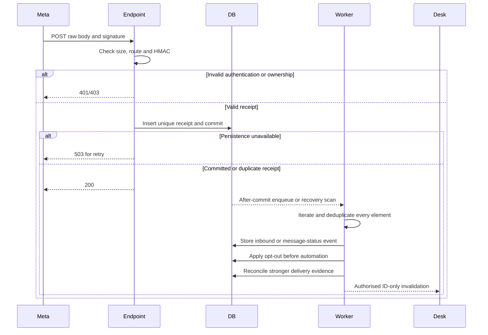

# Webhook and delivery flow

Trigger: Meta callback. Prerequisites: route maps to configured connection and signature validates against raw bytes. GET subscription verification is a separate operation.

Durable acknowledgement means receipt is stored, not that all business processing has completed. Processor failure leaves a retriable/failed record; duplicate envelopes/elements cannot duplicate inbound messages, consent withdrawals or run triggers.

For inbound messages, resolve sender identity without guessing, upsert the company/contact/number conversation, and use the maximum valid provider inbound timestamp for reply-window calculation. Unsupported message types create a safe placeholder; inaccessible or invalid media stays private and unavailable.

For status events, correlate by verified provider identity; keep unmatched events for later matching. Append all evidence. Late Sent never downgrades Delivered/Read. Contradictory Failed evidence remains diagnostic if actual delivery already exists.

If status arrives before the worker recorded acceptance, correlate after the acceptance transaction or using only verified provider correlation fields. Unknown outcomes are not matched merely by similar text/time/phone.

Outcome: replay-safe business events and accurate evidence-derived delivery state. See [API boundary](../API_CONTRACTS.md#webhook-boundary), [P2 tasks](../tasks/P2-CONNECTIONS-AND-WEBHOOKS.md), [WA-A06/WA-A08](../TESTING_AND_ACCEPTANCE.md).
