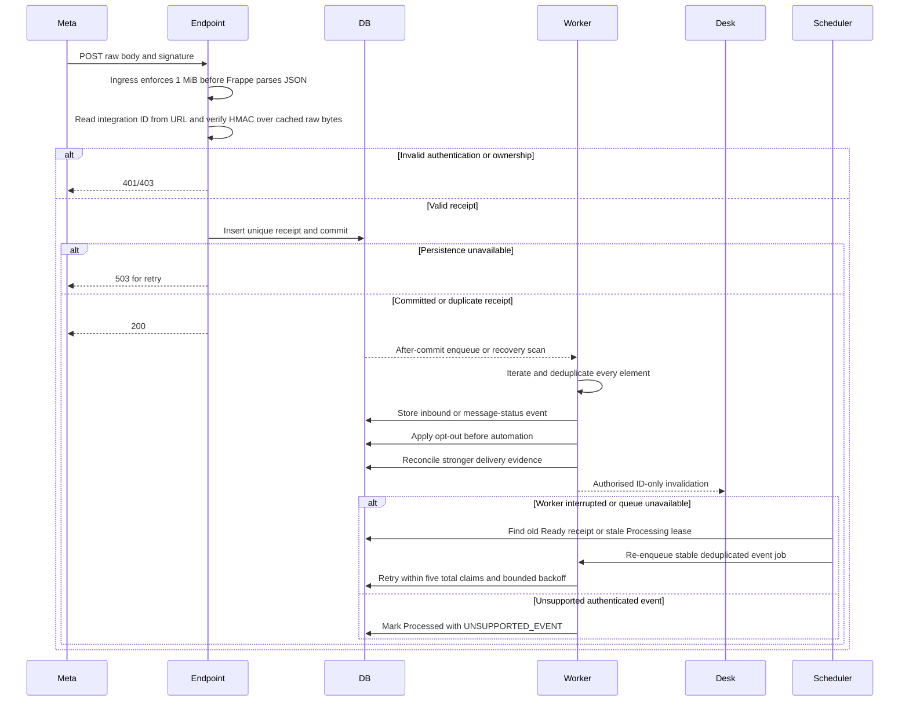

# Webhook and delivery flow

Trigger: Meta callback. Prerequisites: the public route is TLS protected, a route-specific 1 MiB ingress limit runs before Frappe, the integration ID maps to a configured connection and the signature validates against the exact raw bytes. GET subscription verification is a separate operation.

Durable acknowledgement means receipt is stored, not that all business processing has completed. A one-minute recovery scan finds old Ready receipts and stale Processing claims; failures use bounded retry delays and become terminal after five claims. Duplicate envelopes/elements cannot duplicate inbound messages, consent withdrawals or run triggers. The recovery path never retries outbound message submissions.

Frappe v16 initializes `form_dict` by parsing `application/json` before it dispatches to a whitelisted method. The handler therefore reads integration routing only from the URL and reuses the request's cached original body for HMAC verification; it never trusts JSON-derived routing fields. Frappe rejects malformed JSON before the handler with its framework HTTP 417 response. The handler independently checks content type, declared length and the 1 MiB limit, while production ingress must enforce that same per-route size before the framework parser runs. This app-level check cannot replace the edge limit.

For inbound messages, resolve sender identity without guessing, upsert the company/contact/number conversation, and use the maximum valid provider inbound timestamp for reply-window calculation. Unsupported message types create a safe placeholder; inaccessible or invalid media stays private and unavailable.

For status events, correlate by verified provider identity; keep unmatched events for later matching. Append all evidence. Late Sent never downgrades Delivered/Read. Contradictory Failed evidence remains diagnostic if actual delivery already exists.

If status arrives before the worker recorded acceptance, correlate after the acceptance transaction or using only verified provider correlation fields. Unknown outcomes are not matched merely by similar text/time/phone.

Outcome: replay-safe business events and accurate evidence-derived delivery state. See [API boundary](../API_CONTRACTS.md#webhook-boundary), [P2 tasks](../tasks/P2-CONNECTIONS-AND-WEBHOOKS.md), [WA-A06/WA-A08](../TESTING_AND_ACCEPTANCE.md).
